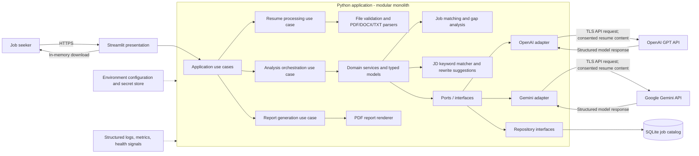
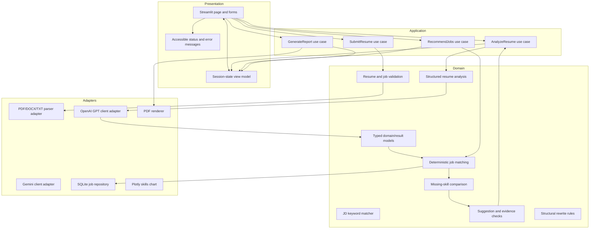
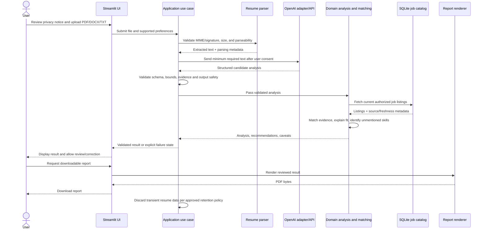

# Software Architecture

## AI Resume Analyzer & Job Recommendation System

| Document detail | Value |
|---|---|
| Status | **Live – v1.1** |
| Version | 1.1 |
| Last updated | 2026-10-21 |
| Related product document | [PRD.md](./PRD.md) |
| Architecture style | Modular monolith |

## 1. Architecture Overview

### 1.1 Goals and constraints

The system accepts a resume (PDF, DOCX, or TXT), extracts and evaluates its content via Google Gemini, identifies role-relevant skills, matches against any pasted job description, recommends jobs from the catalog, and produces a downloadable analysis report. It supports the individual-user MVP in the PRD; it is not a hiring decision system and does not include counselor accounts, institution dashboards, or automated job applications.

The stack is Streamlit, Python, Google Gemini (primary AI provider, with OpenAI as fallback), Plotly (visualisation), SQLite, and pytest. A modular monolith keeps deployment and operations manageable for an initial release while maintaining boundaries that permit components to be replaced as usage grows.

### 1.2 High-level architecture



**Runtime boundaries**

- Streamlit is the web UI and request/session coordinator. It calls application use cases; it does not contain resume-analysis or matching rules.
- Python application services coordinate parsing, AI calls, deterministic matching, JD comparison, persistence, and report rendering.
- The selected Gemini or OpenAI adapter is the only component that knows its provider SDK/API details. Gemini (`gemini-flash-latest`) is the default provider.
- The JD matcher (`services/jd_matcher.py`) performs deterministic keyword extraction, match scoring, and structural rewrite suggestions without calling the AI provider.
- Plotly renders the skills bar chart client-side inside Streamlit.
- SQLite stores the normalized, curated job catalog and its source/freshness metadata. The MVP does not persist raw resumes or analysis output by default; these are processed for the current session and held only as long as required to render results and the report.
- PDF reports are generated on demand and offered as a download. They are not stored server-side by default.
- Configuration and secrets are supplied at runtime; they are not stored in source code or the SQLite database.

### 1.3 Deployment view

Deploy the application as a single Streamlit service behind a TLS-terminating reverse proxy or managed ingress. Store the SQLite catalog on a persistent local volume with restricted filesystem permissions and scheduled, access-controlled backups. Package the Python application and its pinned dependencies in a reproducible deployment artifact.

The initial deployment is a single application instance. SQLite is appropriate for a modest, single-writer workload; it is not a shared database for horizontally scaled application replicas on unrelated local disks. Before scaling beyond this deployment shape, measure contention and move the repository adapter to a server database such as PostgreSQL. The application and domain interfaces should not depend on SQLite-specific SQL.

### 1.4 Storage and retention decisions

| Data | MVP handling | Persistence |
|---|---|---|
| Uploaded resume bytes | Validate and parse in memory; enforce size limits; discard after request/session no longer needs it | No |
| Extracted resume text | Kept only for the active analysis workflow; never written to logs | No |
| Analysis and generated suggestions | Held in Streamlit session state only as long as needed to display/download results | No by default |
| Job listings and source metadata | Normalized records from an authorized curated/licensed source | SQLite |
| API key and runtime secrets | Environment injection or deployment secret manager | No application database |
| Downloadable report | Generated in memory for the download response | No |

The PRD leaves accounts, retention, and job-source decisions open. Before launch, product and privacy owners must approve the user-facing disclosure, exact session/retention behavior, authorized job source and refresh process, and any model-provider data-processing terms. If persistent user analyses are later required, add explicit consent, authentication/authorization, deletion workflows, retention enforcement, migrations, and access auditing before storing them.

## 2. Component Diagram



### Component responsibilities

| Component | Responsibility |
|---|---|
| Streamlit pages/forms | Collect a resume and user preferences, show progress and results, expose corrections, and trigger report download. |
| Session-state view model | Hold only the active workflow's validated result and transient resume data; clear it when the user restarts or the session expires. Avoid treating session state as durable storage. |
| Application use cases | Enforce workflow order, call domain services and ports, translate expected failures into typed application errors, and return results without UI dependencies. |
| PDF/DOCX/TXT parser adapter | Validate and extract text from explicitly supported formats (PDF via pypdf non-strict, DOCX paragraphs + tables, plain TXT); reject encrypted, empty, malformed, oversized, or unsupported files. |
| Gemini client adapter (primary) | Make bounded, authenticated API calls to Google Gemini; use configured model and prompt version; validate structured response shape; normalize provider failures. |
| OpenAI client adapter (fallback) | Same contract as Gemini adapter, for GPT models when configured via `AI_PROVIDER=openai`. |
| JD matcher service | Deterministic keyword extraction from pasted JD text, match scoring, and structural rewrite suggestions. No AI calls — purely regex + set intersection. |
| Domain services | Define evidence-grounded analysis contracts, compare resume evidence to job requirements, identify gaps, and ensure recommendations do not claim a user lacks an unmentioned skill. |
| SQLite job repository | Query active, authorized listings and source metadata using parameterized SQL; provide catalog freshness and source status. |
| PDF renderer | Render the completed report from validated application data, not from raw model output or arbitrary HTML. |
| Plotly skills chart | Horizontal bar chart of all detected skills, shaded by confidence (evidenced vs inferred), rendered client-side in Streamlit via `st.plotly_chart`. |
| Configuration/observability | Load validated runtime settings and secrets; emit privacy-safe structured operational events and health information. |

## 3. Data Flow Diagram



### Data handling rules

1. Validate file extension, content signature, size, and parser output before sending any text to the model provider.
2. Display the processing/retention disclosure before submission. Do not call the external AI service until the user has provided the required consent.
3. Send only the text needed for analysis; do not send the original file or unnecessary session metadata. PII redaction may be added only if tested so that it does not damage analysis quality.
4. Treat resume content as untrusted data, not as instructions. Model prompts must explicitly treat embedded instructions as content and require output to conform to a strict schema.
5. Validate all model responses locally. Use model output as candidate analysis, not as a trusted source of truth.
6. Match jobs using a documented deterministic scoring/ranking method over available catalog fields. Use GPT for resume understanding and suggestions, not to fabricate or silently invent job listings.
7. A missing requirement means “not found in this resume,” not that the user lacks the skill.
8. Keep raw text, uploaded bytes, prompts containing resume content, and full model responses out of logs and telemetry.
9. If recommendations or report generation fail, preserve access to successfully completed analysis and communicate the partial failure.

## 4. Folder Structure

```text
resume-analyzer/
├── app/                            # Streamlit presentation and application entry point
│   ├── config/settings.py          # Validated runtime settings and local .env loading
│   ├── components/
│   │   ├── analysis_view.py        # Six-tab results layout (Insights, JD Match, Jobs, Skills, Checks, Report)
│   │   ├── jd_match_view.py        # JD paste → score gauge, keyword chips, rewrites, Plotly chart
│   │   ├── upload_form.py          # File uploader (PDF/DOCX/TXT) and text area
│   │   └── ...                     # Other UI components
│   ├── pages/
│   │   ├── analyze_resume.py       # Upload and analysis trigger page
│   │   └── results.py              # Results dashboard (calls analysis_view)
│   ├── services/resume_service.py  # Pasted-text and PDF/DOCX/TXT input workflow
│   ├── prompts/resume_prompt.py    # Static, reviewed analysis prompt loader
│   └── utils/logging_config.py     # Privacy-conscious application logging
├── config/                         # Validated settings and logging configuration
├── integrations/                   # OpenAI and Gemini provider adapters
├── models/                         # Typed domain and boundary schemas
├── parsers/                        # Resume file validation and text extraction (PDF, DOCX, TXT)
├── prompts/                        # Versioned, static prompt templates
├── reports/                        # Downloadable report rendering
├── repositories/                   # SQLite catalog access and schema migrations
├── services/                       # Application workflows and dependency ports
│   ├── recommendation_service.py   # Deterministic job matching and gap analysis
│   └── jd_matcher.py               # JD keyword extraction, match scoring, rewrite rules
├── utils/                          # Small cross-cutting, non-domain helpers
├── tests/                          # Unit, integration, contract, and UI tests (175 passing)
├── scripts/                        # Authorized job-catalog maintenance commands
├── data/                           # Runtime catalog only; no user resumes
├── .streamlit/                     # Non-secret Streamlit configuration
├── pyproject.toml                  # Dependencies incl. plotly, google-genai
├── requirements.lock               # Reproducible pinned deployment dependencies
├── .env.example                    # Variable names/placeholders only
├── PRD.md                          # Product requirements (v1.1)
├── SOFTWARE_ARCH.md                # This file
└── README.md                       # Setup, operations, privacy, and catalog guidance
```

The complete proposed file tree, file responsibilities, and dependency direction are documented in [PROJECT_STRUCTURE.md](./PROJECT_STRUCTURE.md). The Streamlit workflow accepts pasted resume text or PDF/DOCX files and validates the extracted text length before AI processing. Do not commit real resumes, API keys, production database files, generated reports, or logs. Add those paths to `.gitignore`. Keep test fixtures synthetic and avoid copying production data into development or test environments.

## 5. Design Patterns

1. **Layered architecture / ports and adapters:** Domain and application code depend on interfaces rather than Streamlit, OpenAI, or SQLite implementations. This allows deterministic unit tests and future provider/storage replacement.
2. **Modular monolith:** Deploy one service but maintain explicit domain, application, adapter, and presentation boundaries. Avoid premature microservices for the initial scale.
3. **Use-case/application service:** Each user action has an explicit application entry point (`AnalyzeResume`, `RecommendJobs`, `GenerateReport`) that owns orchestration and returns typed results.
4. **Repository pattern:** Hide SQLite details behind a job-catalog repository. Expose domain-oriented operations such as `find_active_jobs(...)`, not raw SQL or database connections.
5. **Adapter/anti-corruption layer:** Normalize OpenAI responses and provider exceptions into internal schemas/errors. Provider response types must not leak into domain or UI code.
6. **Strategy pattern:** Keep parsing format-specific and selectable by detected/validated type; allow matching strategies to evolve without changing the workflow contract.
7. **Schema-first boundary validation:** Validate uploaded-file metadata, model output, catalog rows, and report input at component boundaries. Reject invalid output rather than returning partially trusted data.
8. **Dependency injection:** Construct repositories, parsers, and AI clients from validated settings at application startup; tests inject fakes or temporary SQLite databases.
9. **Result/error types:** Represent expected failures explicitly (invalid file, unsupported format, AI unavailable, invalid model response, no catalog results). Do not convert failures into empty successful analyses.

## 6. Security and Privacy Considerations

### Resume and personal data

- Treat resumes, extracted text, generated reports, and analysis results as sensitive personal data.
- Obtain informed consent before transmitting resume content to OpenAI. Before launch, verify provider data-use, retention, regional-processing, and contractual terms against applicable law and organizational policy.
- Minimize data sent to the provider. Do not send original files, user identifiers, or irrelevant metadata.
- Do not use resumes for model training or secondary purposes without separate, explicit, informed consent.
- Enforce documented upload size/page limits and parser timeouts. Reject password-protected or unsupported files with a safe user-facing explanation.
- Do not store raw resumes/results by default. If persistence is introduced, require an approved retention period, deletion mechanism, access control, encryption, migration plan, and audit events.

### Application and infrastructure

- Serve the UI only over HTTPS in production. Restrict access to the SQLite file and backups with operating-system permissions and encryption at the storage layer where available.
- Keep `OPENAI_API_KEY` in a deployment secret manager or protected environment variable. Never place secrets in source, Streamlit config committed to the repository, logs, or SQLite.
- Pin and regularly update dependencies; scan dependencies and the deployment image for known vulnerabilities.
- Validate upload extension and content independently; never trust client-provided MIME type. Use safe temporary-file handling if a parser requires disk access and remove temporary data reliably.
- Use parameterized SQL, read-only database access for catalog queries, and transactional, validated import operations for catalog refresh.
- Treat resume text as prompt-injection-capable untrusted input. The model must not be allowed to execute tools, SQL, URLs, or instructions found in resume content. Do not expose secrets, system prompts, or internal diagnostics in generated output.
- Render reports from escaped/validated structured data. Do not interpret model-generated HTML or arbitrary markup.
- Add request/session protections appropriate to the chosen deployment (including upload limits, session isolation, CSRF/origin protections at the ingress where applicable, and restrictive response headers).
- Avoid serving this individual-user MVP as an institution-wide multi-tenant product without authentication, authorization, tenant isolation, and privacy review.

### AI-specific safeguards

- Use a strict, versioned output schema with bounded field lengths and list sizes. Validate semantics and evidence references in Python before displaying or exporting results.
- Set explicit connection/read timeouts, token/output budgets, and request limits. Retry only transient failures with a small bounded exponential backoff and jitter; do not retry validation failures.
- No recommendation may refer to a job absent from the authorized catalog. Display source/freshness metadata where available.
- Clearly label generated text and inferred skills. Do not generate unsupported facts, scores presented as objective truth, protected-attribute inferences, or hiring/eligibility decisions.
- Provide a clear failure state when output is malformed or unsafe; never substitute a fabricated or empty success response.

## 7. Logging and Monitoring Strategy

### Logging

- Use Python's standard `logging` facade with a structured JSON formatter in production. Keep module-level loggers and configure handlers once at application startup.
- Record operational events such as `resume_upload_rejected`, `analysis_started`, `analysis_completed`, `analysis_failed`, `catalog_stale`, and `report_generated`.
- Include only the minimum useful fields: timestamp, severity, event name, opaque request/session correlation ID, component, duration, and normalized error code. Do not log names, email addresses, resume text, filenames if identifying, prompts, model responses, API keys, or report contents.
- Log expected user-correctable failures at warning/info level; unexpected dependency or application failures at error level with stack traces only when the trace contains no sensitive payload.
- Configure log access controls, retention, rotation, and alerting according to the deployment's privacy/security policy. Do not rely on Streamlit's UI session state as an audit log.

### Metrics and health signals

Track aggregate counts and latency for successful/failed parsing, analysis, recommendation lookup, and report generation; OpenAI timeout/rate-limit/error categories; catalog age; and SQLite busy/locking errors. Metrics must not include resume content or directly identifying labels.

Expose deployment-level liveness/readiness checks where supported. Readiness should verify required configuration and database connectivity; do not make a model API call on every health probe. Alert on sustained analysis failures, elevated latency, stale job catalogs, repeated database locking, and unexpected cost/token growth.

## 8. Error Handling Strategy

### Error boundaries

1. **Presentation boundary:** Catch known application errors and show actionable, non-technical messages. Preserve entered non-sensitive preferences where practical. Never show stack traces, provider payloads, file contents, or secrets.
2. **Application boundary:** Convert adapter failures into typed internal errors and attach a correlation ID. Do not broadly catch and suppress exceptions.
3. **Adapter boundary:** Normalize SDK, parser, filesystem, and SQLite exceptions. Preserve the original exception as a cause for secure diagnostics.
4. **Process boundary:** Unexpected errors are logged with a correlation ID and reported as a generic failure. They must not become empty analysis data or success notifications.

### Error taxonomy and user behavior

| Error category | Example | User-facing behavior | Recovery |
|---|---|---|---|
| Input validation | Unsupported type, too large, empty/corrupt file | Explain the specific constraint | Select a supported/corrected file |
| Parse failure | Encrypted PDF, no extractable text | Explain that the document could not be read | Provide an unlocked/text-based file |
| AI transient | Timeout, rate limit, provider unavailable | Explain temporary analysis unavailability | Bounded retry initiated by user or safe retry policy |
| AI contract/safety | Malformed schema, unsupported claim, invalid evidence | Do not display the result as complete | Retry once only if appropriate; otherwise request a new analysis later |
| Catalog availability | SQLite busy/error, catalog missing/stale | Preserve completed resume analysis and disclose recommendations are unavailable/limited | Retry lookup or refresh catalog operationally |
| No suitable results | No current matching listing | Explain that no suitable current listing was found | Adjust supported preferences or check later |
| Report generation | Renderer error or invalid report input | Keep results available and show download failure | Retry report generation |
| Unexpected internal | Unclassified programming/runtime error | Generic message with correlation ID | Support/operations investigation |

Use finite timeouts for parsing, AI requests, database access, and report generation. Retry only idempotent transient operations and cap attempts. Do not retry file validation failures, invalid model output indefinitely, or catalog writes without idempotency protection. A recommendations failure must not discard a successfully completed resume analysis.

## 9. Testing Strategy

Use pytest with tests organized by unit, integration, contract, and UI layers. Keep the default test suite offline, deterministic, and free of real personal data or paid external API calls.

### Test layers

| Layer | Scope | Technique |
|---|---|---|
| Unit | File validation, evidence handling, skill-gap wording, match scoring, model validation, error mapping, report content construction | Fast tests with synthetic inputs; no network or filesystem dependencies unless isolated |
| Integration | Application workflows, SQLite repository/migrations, catalog freshness and filtering, parser adapters, report generation | Temporary directories and per-test SQLite databases; synthetic PDF/DOCX fixtures |
| Contract | OpenAI structured response schema, required evidence/caveat fields, size bounds, normalized provider errors | Recorded synthetic fixtures and schema validation; separate opt-in live smoke test if approved |
| UI | Upload, progress, results, correction, partial failure, and report-download behavior | Streamlit AppTest or equivalent UI harness; test accessible labels and visible error states |
| Security/privacy | Upload validation, prompt-injection samples, log redaction, no-secret/no-resume persistence, malformed model output | Adversarial synthetic tests and dependency/security scanning |
| End-to-end | Main journey from supported resume upload through analysis, recommendations, and report download | Staging-only tests with stubbed AI and seeded authorized catalog; live AI tests are opt-in |

### Required scenarios

- Valid and invalid PDF/DOCX files, including oversized, encrypted, corrupted, empty, and image-only/unextractable documents.
- Missing, malformed, oversized, and factually unsupported AI response fields.
- Prompt injection embedded in synthetic resume content; verify it is treated as data, not instructions.
- A supported skill with evidence, an inferred skill, ambiguous evidence, and a role requirement not found in the resume.
- No catalog listings, stale listings, expired jobs, missing application links, and SQLite lock/read failures.
- OpenAI timeout, rate limit, authentication/configuration failure, and unavailable service.
- Report generation success and failure, with checks that reports contain expected sections and no hidden diagnostics.
- User correction updates the current analysis/recommendation inputs as specified by the application contract.
- Privacy behavior: no raw resume text in logs, no API key in outputs, transient data cleared on reset/session cleanup.
- Keyboard-usable core UI and accessible names/status announcements for upload, progress, errors, and downloads.

### Quality gates

- Run formatting, linting, type checks (if configured), and `pytest` in CI.
- Require all unit and integration tests to pass before release. Track coverage for critical domain and validation logic; a proposed initial target is at least 85% branch coverage for those modules, not an overall code-quality substitute.
- Use synthetic fixtures only. Any live OpenAI test must be explicitly enabled, isolated from normal CI, use non-personal data, and have a controlled cost budget.
- Test the exact PRD acceptance criteria, especially evidence traceability, no fabricated jobs/claims, “not found in resume” wording, visible failure states, and independent report generation.
- Run representative latency and concurrency tests before production. Validate the PRD's analysis latency and availability targets with production-like deployment conditions.

## 10. Operational Decisions Before Launch

1. Approve supported resume formats, upload limits, and handling of scanned/image-only resumes.
2. Select an authorized job catalog provider, licensing terms, import method, and freshness SLA.
3. Confirm OpenAI model/provider settings, data-processing terms, region, retention configuration, and user-consent language.
4. Decide whether uploads/results remain strictly transient and define Streamlit session cleanup behavior.
5. Define backup/restore, catalog refresh, dependency update, incident response, and secret-rotation procedures.
6. Validate SQLite concurrency under expected load and document the migration trigger to a server database.
7. Confirm the downloadable report format and accessibility requirements with product/design.
